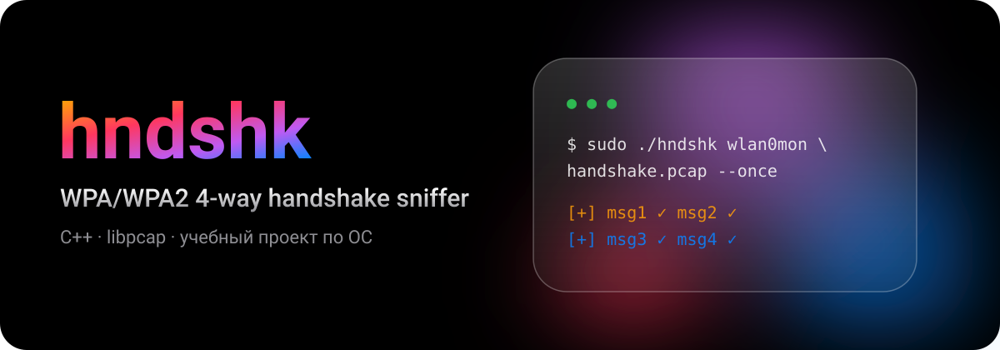

<p align="center">
  
</p>

<p align="center">
  <b>Учебный сниффер EAPOL-кадров для задания по ОС.</b><br>
  Только перехват и сохранение в <code>.pcap</code>. Никакого подбора пароля.<br>
  <sub>C++11 · libpcap · Linux · monitor mode</sub>
</p>

<br>

## ⚡ Быстрый старт

```bash
# 1. зависимости
sudo apt install libpcap-dev

# 2. сборка
g++ -O2 -Wall -std=c++11 -o hndshk handhshake/hndshk.cpp -lpcap

# 3. адаптер в monitor mode
sudo airmon-ng start wlan0

# 4. запуск
sudo ./hndshk wlan0mon handshake.pcap
sudo ./hndshk wlan0mon handshake.pcap -b AA:BB:CC:DD:EE:FF   # только одна точка
sudo ./hndshk wlan0mon handshake.pcap --once                 # стоп после 4 сообщений
```

## 🧠 Как это работает

```
802.11 кадр → radiotap → 802.11 MAC → LLC/SNAP → EtherType 0x888E → EAPOL-Key
```

Тип сообщения определяется по битам поля **Key Information**:

| Сообщение | Направление | ACK | MIC | Secure | Несёт |
|:--:|:--:|:--:|:--:|:--:|:--|
| **msg1** | AP → STA | 1 | 0 | – | ANonce |
| **msg2** | STA → AP | 0 | 1 | 0 | SNonce + MIC |
| **msg3** | AP → STA | 1 | 1 | 1 | GTK |
| **msg4** | STA → AP | 0 | 1 | 1 | подтверждение |

Программа ничего не расшифровывает: узнаёт сообщение по битам и пишет исходный кадр целиком в `.pcap`. Файл открывается в Wireshark.

## 📁 Структура

```
.
├── README.md
├── assets/
│   └── hero.svg
└── handhshake/
    └── hndshk.cpp
```

## ⚠️ Дисклеймер

Использовать только в своей сети или с письменного разрешения владельца. Проект создан в образовательных целях.

<br>

<p align="center">
  <sub>Stay hungry. Stay foolish.</sub>
</p>
